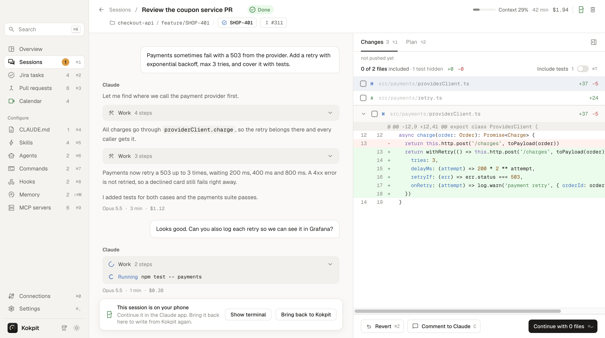
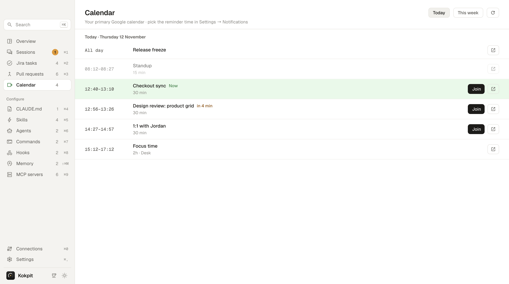
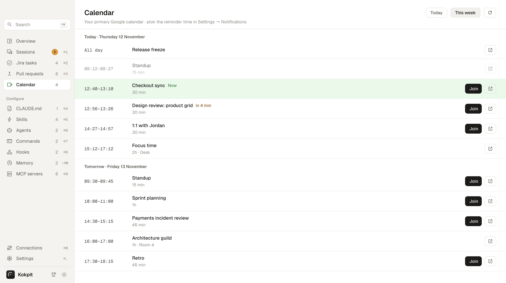

<h1 align="center">Kokpit</h1>

<p align="center">
  A macOS desktop app for everything you do with <a href="https://claude.com/claude-code">Claude Code</a>.
</p>

<p align="center">
  
</p>

Kokpit puts your Claude Code sessions, Jira tasks, pull requests and today's meetings in one window. See which session needs you, read what Claude did, answer it or start a new one, continue it on your phone, and edit your CLAUDE.md, skills, agents, commands, hooks, memory and MCP servers without opening a terminal. A menu bar panel shows the same state when the window is closed.

Built with Electron, React, TypeScript and the Claude Agent SDK. It uses your existing Claude Code login and settings.


---

## Contents

- [Features](#features)
- [Screenshots](#screenshots)
- [Install](#install)
- [Development](#development)
- [Releasing](#releasing)
- [What it reads and writes](#what-it-reads-and-writes)

---

## Features

### Overview
- Sessions waiting for you at the top, with Allow and Open right in the row
- Running and unread sessions in two tabs, with the step Claude is on
- Today's and last 7 days' cost, a cost-per-day chart, and your plan limits (5-hour session and weekly windows)
- Active Jira sprint and your pull requests at a glance

### Sessions
- Every Claude Code session on this Mac, read from your transcripts, filtered by state (needs you, running, error, done), Jira task and tag
- Tags with colours to group sessions; pin sessions to the top and drag to reorder them
- Jira and pull request chips on each row; hover one to see the task status or the PR's checks and reviews
- A session counts as running while it has a background job, a shell included
- Unread dot on sessions that changed since you last looked
- Keyboard first: arrows to move, Enter to open, Y to allow, G W to jump to the next waiting session

### Session detail and chat
- The conversation as the Claude Code CLI shows it: your messages and Claude's answers in the open, tools and thinking grouped in collapsible work blocks
- Approvals, questions, plan approval, retries, errors and notes behave like the CLI
- Subagents, workflow runs and background jobs open live; read a background shell's log or stop a single job
- Continue the session from Kokpit with model, effort and permission mode pickers; slash commands and @ files autocomplete
- Paste images, or drag a file into the message box to insert its path
- Messages sent while Claude works are queued; take one back before it runs, and Esc puts an unanswered message back in the box
- Changes panel: syntax-highlighted diffs, comment on a file and send only the files you select, revert a file, rewind Claude's edits
- Plan panel: read or edit the plan, then approve and implement
- The side panel opens at its default width and can be dragged wider
- Hover the Jira key in the header to see the task

### Continue on your phone
- One click hands a session to Claude Code's Remote Control, so you can pick it up in the Claude app on your phone
- A QR code and link to open it; a phone icon marks the session in every list
- "Bring back to Kokpit" returns the session here; Kokpit's message box stays locked while it is on the phone

### New session
- Pick a repository, an optional title and prompt, model, effort and mode, then start (⌘N)
- From a Jira task, Kokpit offers the task's existing sessions before starting a new one
- Leave the prompt empty to open the session and write the first message there

### Jira tasks
- Your tasks in the active sprint, grouped by status, with linked sessions and pull requests
- Start a session for a task in one click

### Pull requests
- Your open pull requests and the ones waiting for your review
- CI checks (latest run per check) and reviews (approvals, changes requested) per PR

### Calendar
- Connect Google Calendar and see today's meetings or the whole week
- The meeting in progress is marked green, the next one shows the minutes left; Join opens Google Meet, Zoom or Teams
- A reminder 1, 3, 5 or 10 minutes before each meeting, at the time you pick

### Configure
- **CLAUDE.md**: edit the global and per-repo instructions
- **Skills, agents, commands**: create, edit, upload and delete them, with frontmatter fields and a Markdown preview
- **Skill folders**: see and create the files inside a skill, such as `references/*.md`
- **Commands with arguments**: declare one or more arguments; Kokpit fills in `$ARGUMENTS` or `$0`, `$1`…
- **Hooks**: see and edit the hooks Claude Code runs
- **Memory**: browse and clean up Claude's memory files (⇧⌘M)
- **MCP servers**: global and per-project servers in one list

### Menu bar
- Plan usage and the number of sessions waiting, right in the menu bar; the icon turns orange when a session waits and blue when one finished unread
- The meeting in progress or the next one within the hour, with the minutes left; the icon turns green when a meeting is on or about to start
- A panel with waiting, running and unread sessions and today's meetings; click a meeting to join it

### Notifications
- macOS notifications when a session needs you, finishes or stops with an error
- When CI fails on your pull request, someone requests changes, or someone asks for your review
- Before a meeting starts, and when a new Kokpit version is out
- Each event can be turned on or off; click a notification to jump to that session, PR or meeting

### Everywhere
- Search across sessions, skills, agents and rules (⌘K)
- Doctor: checks Claude Code, your login, Remote Control, git, node, python and connections, from the header or Settings
- Keep-awake toggle so your Mac doesn't sleep during long runs
- Right-click menu with copy, paste and link actions
- Light, dark or system theme
- Update check with the notes of every release you skipped, and the update run in a terminal inside the app

---

## Screenshots

**Overview**: what needs you, what's running, usage and plan limits, sprint and pull requests.


The same screen in dark mode.


**Sessions**: every Claude Code session, filtered by state, Jira task and tag.


**Session detail**: the conversation, work blocks, and a syntax-highlighted diff of the changes Claude made.


**Plan review**: read or edit the plan, or approve and implement.


**Continue on your phone**: the session runs through Remote Control and Kokpit shows where it is.



**New session**: repository, title, prompt, model and effort.


**Search** across sessions, skills, agents and rules.


**Jira tasks** in the active sprint, with linked sessions and pull requests.


**Pull requests** with CI checks and reviews.


**Calendar**: today's meetings from Google Calendar, with the one in progress marked.



The whole week.



**CLAUDE.md**: global and per-repo instructions.


**Skills**, with the files inside a skill folder.


**Agents**


**Commands**, with arguments.


**Hooks**


**Memory**


**MCP servers**


**Connections**: GitHub, Jira and Google Calendar accounts.


**Menu bar panel**: plan usage, waiting, running and unread sessions, and today's meetings.

<p align="center">
  
</p>

**Settings**

| | |
|---|---|
| General  | Claude  |
| Notifications  | GitHub  |
| Sessions  | Doctor  |
| About  | |

All screenshots use demo data.

---

## Install

### Homebrew (recommended)

```bash
brew update
brew install --cask imonursahin/tap/kokpit
```

Opens with no extra steps. The cask clears the quarantine flag on install.

To update later, use **Settings → About → Check for updates**, or run:

```bash
brew upgrade --cask kokpit
```

### Manual

Download the latest release from the [Releases](https://github.com/imonursahin/kokpit/releases) page and drag **Kokpit** into Applications. The app is unsigned, so the first launch needs **right-click → Open**, then confirm.

If macOS says **"Kokpit is damaged and can't be opened"**, Gatekeeper has quarantined the unsigned download. The app is fine. Clear the flag once, then open it:

```bash
xattr -cr /Applications/Kokpit.app
```

### Build from source

```bash
git clone https://github.com/imonursahin/kokpit.git && cd kokpit
npm install
npm run dist
```

This writes `dist/mac-arm64/Kokpit.app`, ad-hoc signed for this Mac. Drag it into Applications.

### Requirements

- macOS on Apple Silicon (arm64)
- A Claude Code login on this Mac. Claude Code ships inside the app; Settings → Claude can point Kokpit at another `claude` binary.
- To build from source: Node 20+ (arm64 build)

---

## Development

```bash
npm install      # install deps and set the dev app name
npm run dev      # start the app with hot reload
npm test         # unit tests (vitest)
npm run typecheck
npm run build    # build into out/
npm run dist     # build the .dmg and .zip into dist/
```

No API keys are needed to build or run. Jira, GitHub and Google Calendar are connected from the Connections page.

---

## Releasing

Releases are automatic. Every push to `main` that changes more than the README or `docs/` starts the [Release workflow](.github/workflows/release.yml). It takes the latest release, bumps the patch version (0.1.0 → 0.1.1), tests and builds the app, publishes the `.dmg` and `.zip` as a GitHub Release, and updates the cask in [imonursahin/homebrew-tap](https://github.com/imonursahin/homebrew-tap). The version in `package.json` is not used for this and does not need to be changed.

For a minor or major version, run the workflow from the Actions tab and enter the version, e.g. `0.2.0`.

Installed apps check for a new version 10 seconds after launch and every 4 hours, show a notification, and update through Homebrew in one click.

The workflow needs one repository secret, `TAP_DEPLOY_KEY`: a deploy key with write access to the tap.

---

## What it reads and writes

- **Sessions**: `~/.claude/projects/**/*.jsonl`, read only. An index is cached in the app's data folder.
- **Skills, agents, commands, hooks, CLAUDE.md**: `~/.claude/` and the `.claude/` folder and `CLAUDE.md` of every repo your sessions worked in. Saving writes the file.
- **Kokpit's own assistant**: `~/Kokpit` (its CLAUDE.md, skills, agents and memory).
- **Jira, GitHub and Google Calendar tokens**: encrypted with the macOS Keychain in the app's data folder. They never leave this Mac. Google Calendar is read only.
- **Continue on your phone**: runs `claude --resume <session> --remote-control` in the session's folder. The session then goes through Claude Code's Remote Control, the same as starting it from a terminal.
- **Plan usage**: read from your Claude Code login through the Claude Agent SDK.
